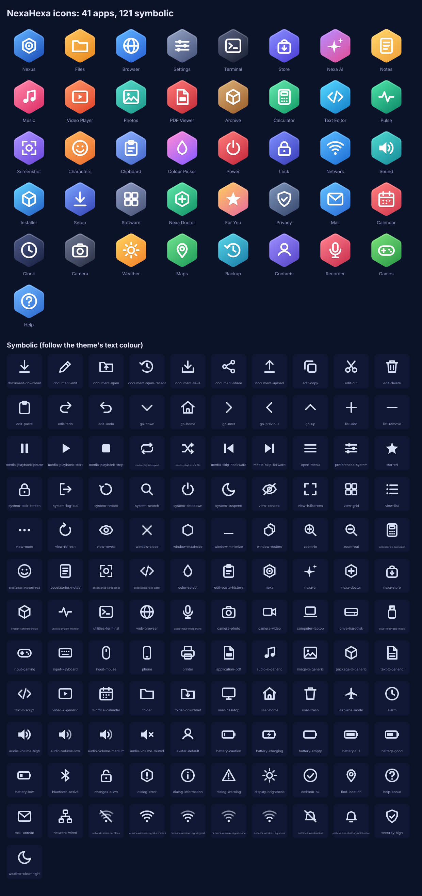
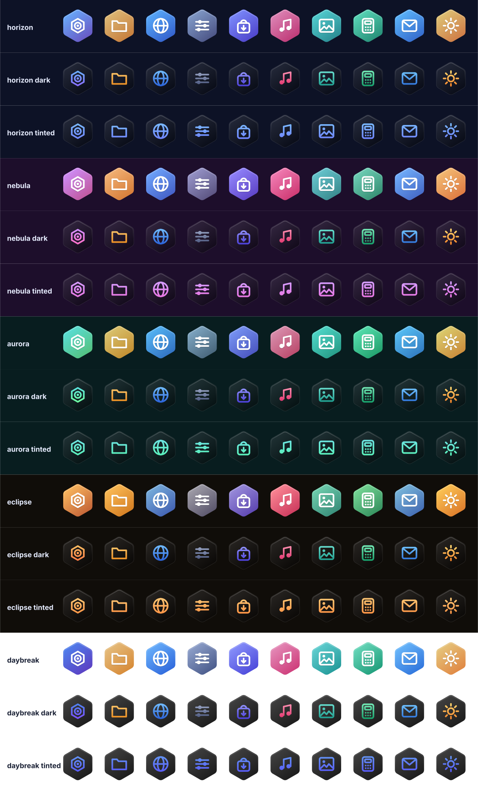

# NexaHexa: the NexaOS icon set

In the image since 2026-10-25 (scripts/stage-iconset.sh puts every set in
/usr/share/icons); the current theme and icon style pick one at login and
on every change.

- **41 app icons** (`NexaHexa/scalable/apps/nexa-*.svg`, 128x128): a white
  glyph on the NexaOS hexagon tile in the app's own gradient. The names
  match the `Icon=` of today's apps (nexa-files, nexa-settings, ...) plus
  apps to come (Mail, Calendar, Camera, Maps, Weather, Backup, ...).
- **121 symbolic icons** (`NexaHexa/scalable/<context>/<name>-symbolic.svg`,
  24x24) with freedesktop names (go-previous, edit-copy, battery-low,
  network-wireless-signal-good, ...), so GTK picks them up by name. They
  are made of filled shapes only: GTK 3 recolours symbolic icons through
  their fill, so they follow the theme's text colour in light and dark.

## The icons shift with the theme

Each NexaOS theme has its own variant, `NexaHexa-<theme>` (horizon, nebula,
aurora, eclipse, daybreak): the same app tiles, each app keeping its own
colour but tinted toward the theme's accent (lifted on the light Daybreak),
and the NexaOS mark (Nexus) in the theme's own accent. The variants only
hold app tiles and inherit everything else from NexaHexa.

Each theme also has two more styles, chosen in Settings > Personalization
("App icons: Colour / Dark / Tinted"), like iOS 18's dark and tinted icons
but on NexaOS's hexagon:

- **Dark** (`NexaHexa-<theme>-dark`): a dark hexagon in the theme's depth,
  the glyph in the app's own colours;
- **Tinted** (`NexaHexa-<theme>-tinted`): the same dark hexagon, every glyph
  in the theme's accent: one colour across the desktop.

Dark tiles have a faint light edge so they keep their shape on a dark
desktop, and the NexaOS mark takes the theme's accent in every style.

Once installed, `themes.icon_theme_for()` picks the variant for the current
theme (written to GTK's settings.ini), and `themes.follow_icon_theme()`
switches open apps, the Dock and the desktop live when the theme changes
(the same watcher that recolours them). The variants are generated from
`themes.txt`, which `make iconset` writes from themes.py, so they always
match the real themes.

## Made by code, not drawn by hand

Every icon is a list of shapes on a 24-unit grid in
`forge/src/icons.rs`; `forge` (Rust, no dependencies, not shipped in the
OS) turns them into both kinds of icon, `index.theme` and `preview.svg`.
Change a shape, a colour or the stroke width there and rebuild:

    make iconset

Its tests check that symbolic icons have no strokes, every app has its
glyph, names are unique and every shape stays inside the grid.

## How it is switched on

1. `scripts/stage-iconset.sh` copies NexaHexa and its 15 theme/style sets
   to /usr/share/icons; build-disk-image.sh builds their caches.
2. `themes.apply()` (at login and on every change) writes the set to
   GTK's settings.ini **and** to GSettings' keyfile
   (`~/.config/glib-2.0/settings/keyfile`, `icon-theme`): on Wayland GTK 3
   reads the icon theme from GSettings, and NexaOS has no dconf, so the
   session runs with `GSETTINGS_BACKEND=keyfile`. Every GTK app, ours or
   not, picks it up, and follows a change live.
3. Nexus and the For you card show a NexaHexa tile as it is (no hexagon
   drawn behind it), with an accent outline when it's lit.
